<p align="center">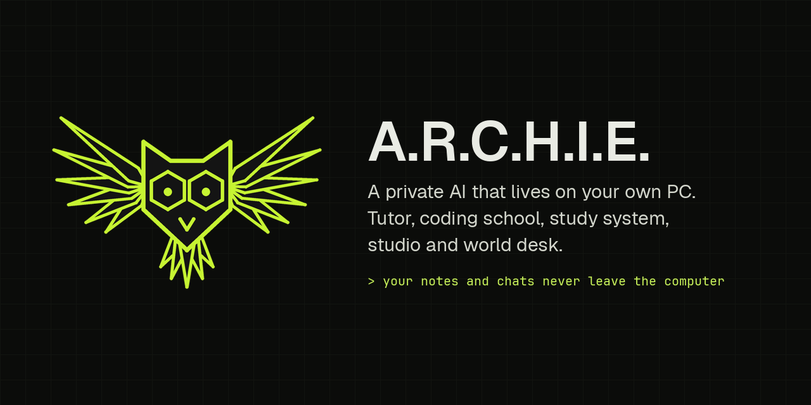</p>

<p align="center">
  <b>Artificial Reasoning Core, Home Intelligence Engine</b><br>
  A desktop companion that runs local AI models on your own Windows PC: a tutor, a coding school, a study system, an art studio and a world desk.
</p>

<p align="center">
  <a href="#what-it-does">What it does</a> ·
  <a href="#set-up">Set up</a> ·
  <a href="#how-it-works">How it works</a> ·
  <a href="#privacy">Privacy</a> ·
  <a href="Manual/Archie%20Manual.md">Manual</a> ·
  <a href="CHANGELOG.md">Changelog</a>
</p>

---

A small owl sits on your desktop. Click it, or press <kbd>Ctrl</kbd>+<kbd>Alt</kbd>+<kbd>A</kbd> from anywhere, and you're talking to a model running on your own graphics card through [Ollama](https://ollama.com). It reads your notes, your Obsidian vault and an offline copy of Wikipedia, and it says where each fact came from. Your chats, notes and recordings never leave the computer.

It started as one chat window and grew, over more than forty releases, into the rest of this page. It runs comfortably on an 8 GB graphics card (an RTX 2080).

<p align="center">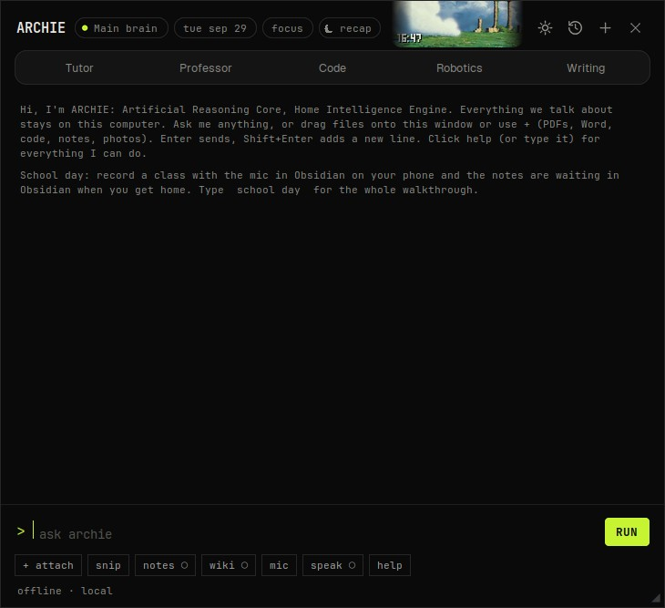</p>

## What it does

### Talk and learn
- **Modes:** General, Tutor (hints, one step at a time), Professor (first principles, a worked example, the usual mistakes), Code, Robotics (pin-by-pin wiring and safety) and Writing. Add your own as a text file.
- **Reads what you give it:** PDF, Word, EPUB, code, notebooks and photos. Snip any part of the screen with <kbd>Ctrl</kbd>+<kbd>Alt</kbd>+<kbd>S</kbd> and ask about it.
- **Sources on every answer:** your notes, past chats, Obsidian and offline Wikipedia.
- **Voice:** ask out loud and hear the answer in one of four offline voices (Whisper and Piper).

### Your day
- A **morning brief**: countdowns, today's classes and tasks, last night's recap, where you left off.
- A **calendar** you type in plain words (`exam: bio midterm oct 12 9am`), with a week view that glows where you focus best.
- An **owl focus timer** whose wings unfold as the session runs, an **evening recap** you talk through, and **patterns** that show your best hours and what's slipping.

<table>
<tr>
<td width="50%">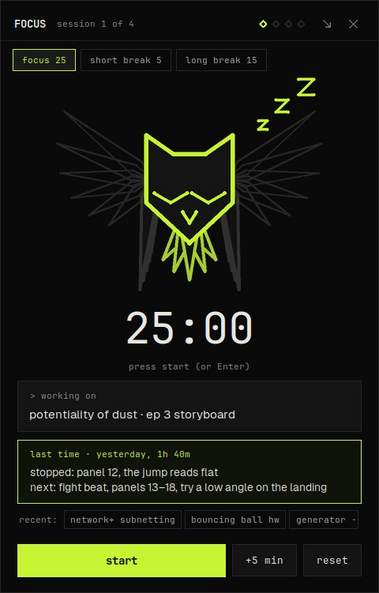</td>
<td width="50%">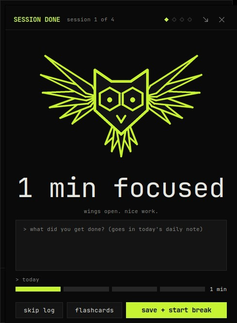</td>
</tr>
</table>

### Study
- **Lecture capture:** record a class on your phone; the PC wakes itself afterwards, types it out and writes the note (summary, key points with times, terms, to-dos, review questions, a mind map).
- **Flashcards** with spaced review from a topic, a note, a chat, a book chapter or a file, checked the way a professor would.
- **Mock exams** with timing and partial credit, and **chapter quizzes** on any book that never spoil what comes later.

### Workshop: a coding school with no internet
- **Teach me to build it:** a project becomes small lessons; you write the code and Archie runs it and gives a nudge, not the answer.
- **Build it for me:** Archie writes, runs and fixes its own errors, with every change shown and undoable.
- **Six courses** built like CS50 (Python, Java, Web, C#, C++, C), about 160 exercises graded by real tests.
- **Real checkers** on every save (ruff, the compilers, javac, node), and answers that **look things up first** in offline docs and Stack Overflow.
- **A library** of about 40 tested building blocks and 8 whole apps for places with little money and no signal: a farm log, clinic medicine stock, class attendance, a savings-group ledger, a water tank alarm, soil-moisture irrigation.

<table>
<tr>
<td width="50%">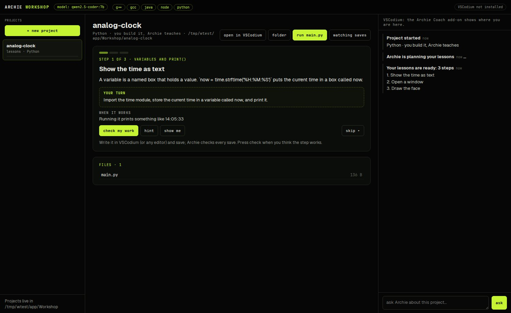</td>
<td width="50%">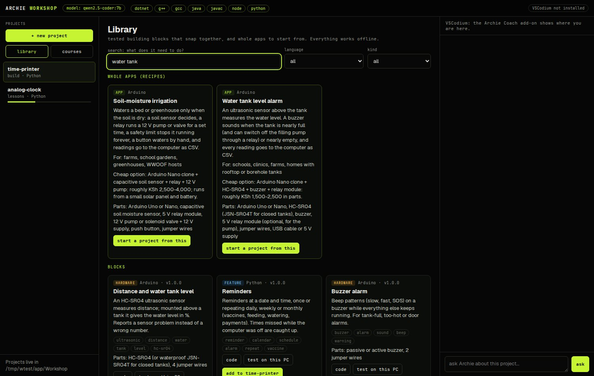</td>
</tr>
</table>

### Studio
- **Image making** with Stable Diffusion XL on your graphics card.
- **Sketch to image:** keep your own lines and poses, pick how closely to follow them and one of 20 styles.
- **Drawing gym:** timed reference practice, sorted by the vision model, with streaks.

<p align="center">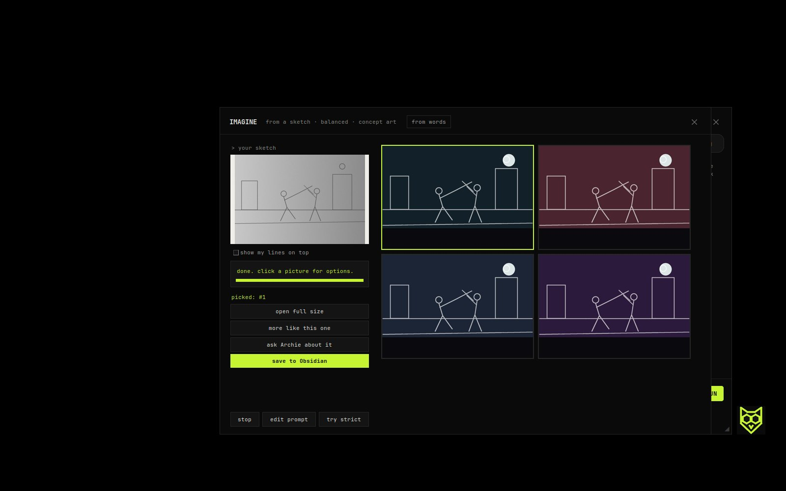</p>

### Archie World: the world desk
The one part that needs the internet. It's about the world, not you.

<p align="center">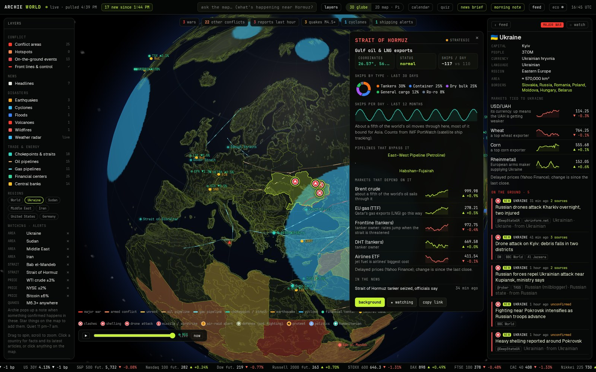</p>

- **The globe:** conflict reports from both sides, translated on your PC and marked unconfirmed until a second source agrees; earthquakes, storms with their forecast cones, weather radar, pipelines, shipping straits, mines, satellites and the ISS on their real orbits.
- **The news:** a 6 am edition with the left / center / right coverage of each story, timelines, explainers, lessons and a quiz.
- **Governments and lawmaking:** every country's briefing with its cabinet as an org chart, and bills and recorded votes from 24 parliaments, all from public records with no ratings.
- **Space:** an orrery with every planet where it is today, 33 spacecraft, the Milky Way with every confirmed exoplanet, and on out to the edge of the observable universe.

<table>
<tr>
<td width="50%">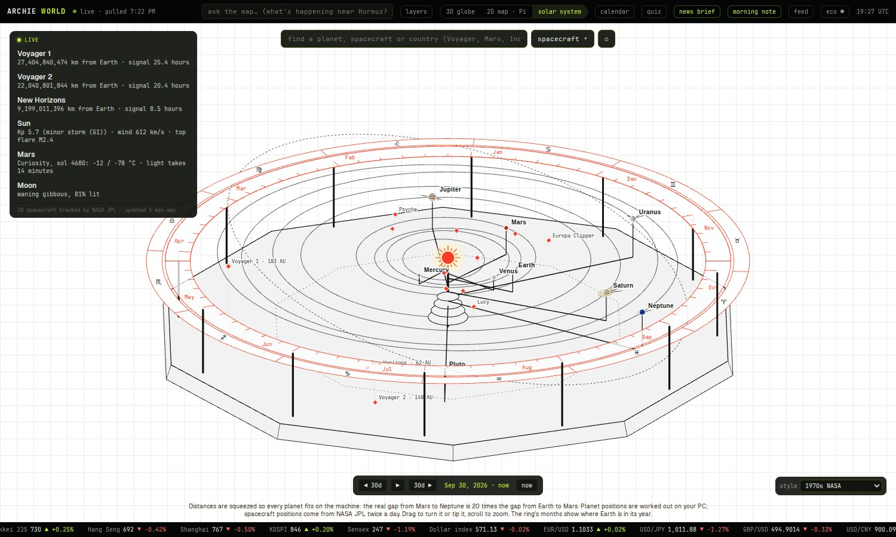</td>
<td width="50%">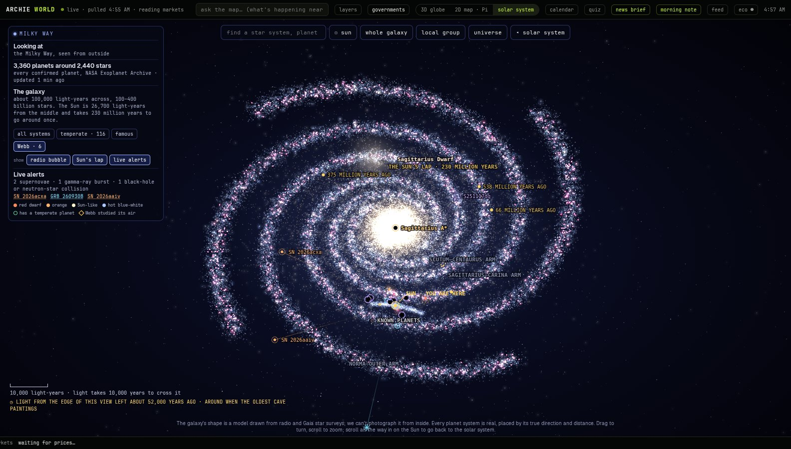</td>
</tr>
</table>

### And
- **The Vault:** an offline library (Wikipedia, medical guides, repair manuals, textbooks, storybooks) on shelves by subject and age. It's also its own project: [BuildBeyond1889/vault](https://github.com/BuildBeyond1889/vault).
- **Obsidian:** save any answer as a linked note, turn a conversation into a cross-linked wiki, ask about the note you have open, and keep your to-dos in the daily note.
- **Feather:** an encrypted version on a USB stick for any laptop: [BuildBeyond1889/feather](https://github.com/BuildBeyond1889/feather).

The [manual](Manual/Archie%20Manual.md) covers every feature, every command and every setting.

## Set up

Windows 10 or 11, an NVIDIA graphics card (8 GB is plenty), Python 3.10 or newer, and about 15 GB for the models.

1. Install [Ollama](https://ollama.com) and [Python](https://www.python.org) (or Anaconda).
2. Download this repository (green **Code** button, then **Download ZIP**) and unzip it, for example to `D:\Archie`.
3. Double-click **Setup Archie.bat**. It starts Ollama, downloads a small starter model and opens Archie.
4. Optional extras, each its own double-click (online, once):

| File | Adds |
|---|---|
| `Get Models.bat` | The full set of models: main, coder, vision (about 13 GB) |
| `Install Extras.bat` | PDF and Word reading, drag and drop, the offline library reader, notes search |
| `Get Wikipedia.bat` | All of English Wikipedia, text only (about 53 GB) |
| `Get Voice.bat` | Voice notes and talking (Whisper and Piper) |
| `Get Handwriting Model.bat` | A better reader for handwriting and scans |
| `Get Image Maker.bat`, `Get Sketch Model.bat` | Image making and sketch to image (about 10 GB) |
| `Get Code Editor.bat` | VSCodium with offline AI and the Archie Coach add-on |

From then on, **Start Archie.bat** opens it, and the owl's right-click menu has everything else.

## How it works

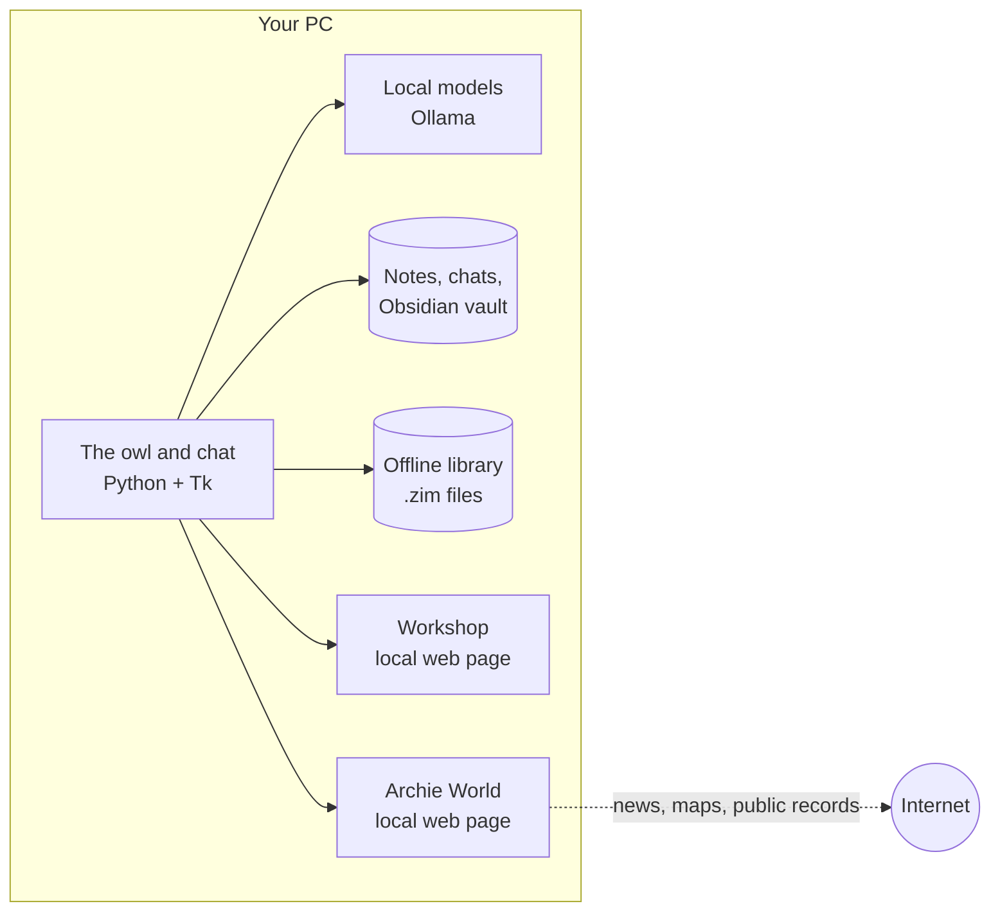

- **One desktop app in Python** (`archie.py` and the `archie_*.py` modules beside it). The chat, brief, calendar, timer, study and studio windows are Tk.
- **Two local web pages** for the bigger screens: the Workshop and Archie World (`World/web`), served by Archie on `127.0.0.1` only and opened in an app window.
- **Everything is a plain file:** chats, flashcard decks, tasks, the calendar, settings. If something breaks, nothing is lost.

| Path | What's in it |
|---|---|
| `archie.py` | The owl, the chat window and the parts that tie everything together |
| `archie_*.py` | One module per feature: `archie_brain.py` (notes search), `archie_study.py`, `archie_workshop.py`, `archie_world.py`, `archie_civic*.py` (governments and lawmaking), `archie_vault.py` … |
| `Modes/` | One text file per mode; edit them or add your own |
| `Manual/` | The manual's source; Archie builds the HTML version from it |
| `World/web/` | Archie World and the Workshop's pages, with the libraries and map data they use |
| `World/workshop/` | Courses, building blocks, whole-app recipes, the VSCodium add-on |
| `fonts/` | Geist, JetBrains Mono, Micro 5, Atkinson Hyperlegible, Young Serif (all SIL OFL) |
| `tests/` | Automatic checks, run by GitHub on every push |

## Privacy

- Chats, notes, recordings, your calendar and your **About me** file stay on your PC. They're not part of this repository, and Archie never uploads them.
- The models run locally. Nothing you type is sent to an AI company.
- Archie World fetches news, maps and public records when you open it, and the lawmaking screens can use free API keys you paste in yourself. Those keys are saved on your PC, never here.

## Tests

```
pip install pytest
pytest
```

The tests compile every module, check every course and recipe file, make sure no personal files or keys are in the repository, and run each building block's own test the way the Workshop does (Python, JavaScript, C, C++, Arduino, plus Java and C# when those tools are installed).

## Built with

Python and Tk, [Ollama](https://ollama.com) running Qwen 2.5 and Gemma 3, [faster-whisper](https://github.com/SYSTRAN/faster-whisper), [Piper](https://github.com/rhasspy/piper), [Stable Diffusion XL](https://github.com/Stability-AI/generative-models) through [diffusers](https://github.com/huggingface/diffusers), [libzim](https://github.com/openzim/python-libzim), [globe.gl](https://github.com/vasturiano/globe.gl), [D3](https://d3js.org) and [satellite.js](https://github.com/shashwatak/satellite-js). Full credits and licences: [THIRD-PARTY.md](THIRD-PARTY.md).

Windows only for now: the hotkeys, wake-after-class and app launching use Windows features.

## Licence

A.R.C.H.I.E. is under the [MIT licence](LICENSE). The libraries, fonts, data and models it uses keep their own licences, listed in [THIRD-PARTY.md](THIRD-PARTY.md).
